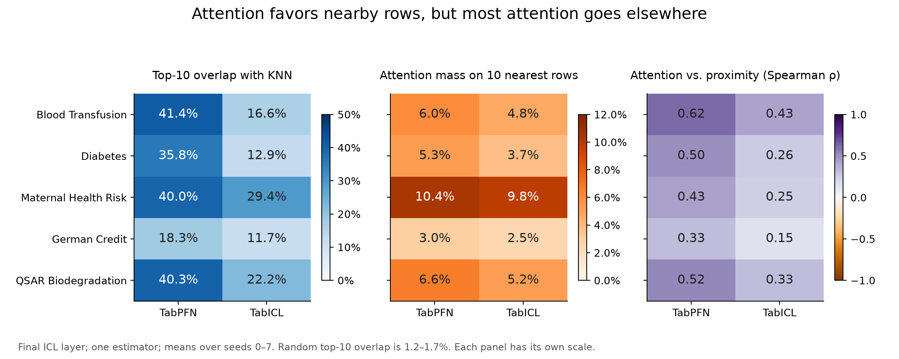

# Do TabPFN and TabICL Attend Like k-Nearest Neighbors?

Course project, SSY340 / DIT969 Deep Machine Learning, Chalmers University of Technology / University of Gothenburg.

TabPFN and TabICL are transformer models that classify a table row by reading the
whole training set "in context", with no gradient training on the task. A natural
guess is that they act like a learned k-nearest neighbors (KNN) classifier. We test
this on five class-imbalanced OpenML datasets with eight random splits each. We
extract the attention from every test row to every training row, compare the most
attended rows with the Euclidean nearest neighbors, and check what happens to
accuracy when the model may only see the k nearest training rows.

## Key findings

All numbers are means over eight seeds with one estimator per model. The source
tables are in `summary/tables/`.

- **Attention prefers nearby rows far more than chance.** In the final attention
  layer, the 10 most attended training rows overlap with the 10 nearest neighbors
  by 18.3% to 41.4% for TabPFN (mean 35.2% over datasets) and 11.7% to 29.4% for
  TabICL (mean 18.5%). A random choice of 10 rows gives 1.2% to 1.7%.
  (`attention_final_k10.csv`)
- **But most attention goes elsewhere.** The 10 nearest neighbors receive only
  3.0% to 10.4% of TabPFN's attention and 2.5% to 9.8% of TabICL's.
  (`attention_final_k10.csv`)
- **Cutting the context to the nearest neighbors always hurts.** When each test
  row only sees its k = 10 nearest training rows, accuracy drops by 2.4 percentage
  points on average for TabPFN (0.9 to 3.7 by dataset) and 6.3 points for TabICL
  (2.9 to 8.9). Even with k = 50 the drops are 0.8 and 2.8 points. Accuracy fell in
  all 40 dataset, model and k combinations. (`restricted_vs_full_summary.csv`)
- **With full context, the foundation models are more accurate than KNN (k = 5)
  on all five datasets.** For example on Maternal Health Risk, TabPFN reaches 86.8%
  accuracy and TabICL 86.4%, against 69.0% for KNN. On Blood Transfusion the
  accuracy gap is small (78.3% vs 77.4%), and KNN is better on balanced accuracy
  (62.9% vs 60.4% for TabPFN and 60.8% for TabICL) and macro F1 (64.3% vs 61.6%
  and 62.0%). (`baseline_summary.csv`)

So the models use locality, but they are not just a KNN: they also draw on rows
far from the query.



More figures are in `summary/figures/`.

## Limitations

- Attention overlap shows association with locality, not causal importance.
- Duplicate rows are kept. In Maternal Health Risk, 562 of 1014 rows repeat an
  earlier row (215 of 748 in Blood Transfusion). Duplicates and distance ties can
  change which row indices count as "nearest".
- The OpenML ids in `tabknn/data.py` have not all been checked against the
  TabArena-v0.1 copies. Maternal Health Risk uses the TabArena copy (id 46941).
- The eight splits share observations, so the error bars are seed standard
  deviations, not confidence intervals.
- Restricted-context results include simple fallbacks: a context with one class
  predicts that class, and a context with identical features uses a majority vote.
- The attention adapter reads model internals and only supports the versions
  listed below.

## Layout

```
tabknn/
  data.py        load the 5 OpenML datasets, shared preprocessing, train/test split
  models.py      make_model("knn" | "tabpfn" | "tabicl")
  neighbors.py   nearest neighbor sets, top-k rows by score, overlap metric
  attention.py   test-to-training attention from every ICL layer
  evaluate.py    metrics with the full context or only the k nearest rows
scripts/
  run_baseline.py            accuracy of KNN vs TabPFN vs TabICL
  run_attention.py           RQ1: attention/KNN overlap and locality
  run_restricted_context.py  RQ2: context cut to the k nearest neighbors
  finalize_experiments.py    KNN k grid, consistency checks, summary tables
  plot_attention.py          attention figures from saved results
  export_summary.py          copy final figures and tables into summary/
  build_attention_notebook.py   rebuild the analysis notebook
tests/           unit tests (attention reconstruction, restricted-context resume)
notebooks/       attention_analysis.ipynb with saved outputs
summary/         final summary tables and figures (used in this README)
data/            OpenML cache (created on first run, not in git)
results/         raw experiment outputs (created by the scripts, not in git)
```

## Setup

Requires [uv](https://docs.astral.sh/uv/). Versions are pinned in `uv.lock`.

```bash
uv sync --locked                        # light install: KNN pipeline only
uv sync --locked --extra foundation     # adds TabPFN, TabICL and torch (large)
```

The attention adapter supports **TabPFN v3.5 weights (`TabPFNV3p5`, package
`tabpfn==9.1.0`)** and **TabICLv2 (`tabicl==2.2.0`)**. Other architectures stop
with `NotImplementedError` instead of giving wrong row indices. TabPFN downloads
its weights on first use and may ask for a Hugging Face login (put the token in a
local `.env`, which is gitignored). Attention instrumentation must run in a single
thread.

## Tests

The tests need the `foundation` extra (they import torch).

```bash
uv run python -m unittest discover -s tests -v
```

## How to run

Quick check (KNN only, downloads the datasets, about 30 seconds):

```bash
uv run python scripts/run_baseline.py --models knn --output results/baseline_knn.csv
```

The full experiments (eight seeds, one estimator per model), in order:

```bash
uv run python scripts/run_baseline.py --models knn tabpfn tabicl --seeds 0 1 2 3 4 5 6 7 --n-estimators 1 --output results/baseline_8seeds_single_estimator.csv
OMP_NUM_THREADS=2 MKL_NUM_THREADS=2 uv run python scripts/run_attention.py --seeds 0 1 2 3 4 5 6 7 --n-estimators 1 --output-dir results/final_8seeds/attention
OMP_NUM_THREADS=1 MKL_NUM_THREADS=1 uv run python scripts/run_restricted_context.py --seeds 0 1 2 3 4 5 6 7 --n-estimators 1 --workers 16 --output-dir results/final_8seeds
uv run python scripts/finalize_experiments.py
```

Each run saves results as it goes, so an interrupted run resumes where it stopped.
Every dataset is class-imbalanced, so each run records accuracy, balanced accuracy,
macro F1, minority-class F1, MCC and ROC AUC. The attention run checks that the
instrumentation does not change any prediction. The finalizer checks that every
seed, model and k combination is present and writes `manifest.json` only if all
checks pass.

Figures and the summary, after the runs above have finished. Run these in order,
because `export_summary.py` copies figures made by the two scripts before it:

```bash
uv run python scripts/plot_attention.py              # attention figures (no model inference)
uv run python scripts/build_attention_notebook.py    # notebook and its extra figures
uv run python scripts/export_summary.py              # copy final tables and figures into summary/
```

## Notebook

`notebooks/attention_analysis.ipynb` holds the full data, model, attention,
restricted-context and plotting code with saved outputs and short notes. It reuses
saved runs from `results/` and computes missing ones. Set `RERUN_BASELINE`,
`RERUN_ATTENTION` or `RERUN_RESTRICTED` to rerun finished experiments. Rebuild it,
together with a portable HTML export, with:

```bash
uv run python scripts/build_attention_notebook.py
```
